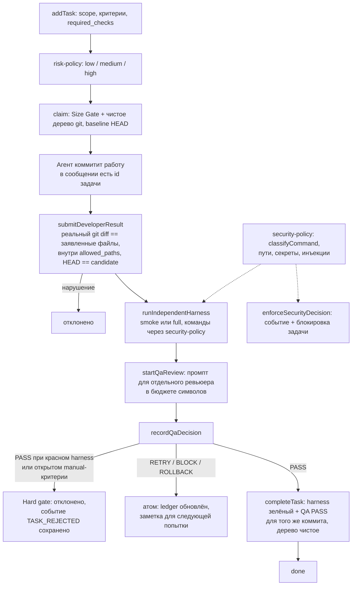

# quality-gate

**English summary.** `quality-gate` is a small TypeScript library that sits between an AI coding agent and your repository and decides whether the agent's change may be accepted. It does not trust the agent's report: it re-reads the real git diff, checks it against the declared scope, runs the checks itself, and refuses a reviewer's "PASS" unless the harness is green for that exact commit. Configurable regex/heuristic risk and security policies determine how much verification a task needs and which shell commands are allowed; the library was extracted from a larger private monorepo tool, and all project-specific paths and vocabulary are now configuration. It includes a library and offline demo (`npm run demo`), uses no external APIs, has 136 tests, is Windows-verified, and the rest of this document is in Russian.

---

## 1. Проблема и для кого

Когда ИИ-агент (Claude, Codex и т. п.) пишет код автономно, у него есть три слабых места:

1. **Он сам говорит, что всё готово.** Заявление «тесты прошли» и «менял только эти файлы» ничем не подтверждено.
2. **Второй ИИ-агент (ревьюер) может ошибиться** и поставить «PASS» на красных тестах.
3. **Опасные действия и деньги.** Задача про платежи, авторизацию или `git push --force` не должна идти по тому же облегчённому пути, что правка опечатки.

`quality-gate` — слой проверки между «агент закоммитил» и «изменение принято». Он рассчитан на тех, кто строит агентный конвейер (планировщик → разработчик → независимый QA) и хочет, чтобы решение «принять» принималось детерминированным кодом, а не словами модели.

## 2. Как устроено



Модули (`src/`):

| Файл | Назначение |
|---|---|
| `gate.ts` | класс `QualityGate`: жизненный цикл задачи, hard QA gate, восстановление после сбоя ревьюера |
| `harness.ts` | выбор режима `smoke`/`full`, запуск проверок подпроцессом, разбор Windows-запуска `.cmd` |
| `security-policy.ts` | классификация команд (`SAFE` / `REQUIRES_REVIEW` / `DENIED`), секретные пути, границы workspace, эвристика prompt injection |
| `risk-policy.ts` | риск задачи `low` / `medium` / `high` по тексту и путям |
| `size-gate.ts`, `reuse-gate.ts` | «слишком большая задача» и «проверь, нет ли готового решения» |
| `config.ts` | схема конфигурации (zod), значения по умолчанию, `loadConfigFile` |
| `store.ts` | ledger: `MemoryStore`, `FileStore` (атомарная запись, ретраи rename на Windows) |
| `git.ts`, `prompt-budget.ts`, `types.ts` | git-хелперы, бюджет промпта, типы |

## 3. Ключевые решения и почему

- **Ничего не принимается «на слово».** `submitDeveloperResult` сверяет заявленный список файлов с `git diff base..candidate`, требует, чтобы коммит был текущим `HEAD`, потомком baseline, содержал id задачи в сообщении и не выходил за `allowed_paths`/`forbidden_paths`. Тест: удалённый файл, который агент «забыл» указать, отклоняется.
- **Hard QA gate.** `PASS` от ревьюера отклоняется, если harness не `pass` для этого коммита, провален детерминированный критерий или открыт `manual_required`. Решение модели не может перевесить красные проверки.
- **Проверки запускает сам gate**, а не агент. Каждая команда сначала проходит `classifyCommand`; неразрешённая команда не запускается.
- **Три статуса harness: `pass` / `fail` / `error`.** «Тест упал» и «не удалось запустить» (spawn ENOENT/EINVAL, сломанный cwd) — разные вещи; различаются по форме ошибки Node (числовой `code` против строкового `code` + `syscall: spawn…`).
- **Режим проверки растёт с риском.** Medium/high риск, повторная попытка или «рискованные» пути (`harness.fullRiskPaths`) → `full` вместо `smoke`.
- **Всё про конкретный проект — в конфиге.** Пути (`packages/db/**`), словарь (деньги, внутренняя экономика), имя продукта для исключения «исследование конкурентов». По умолчанию — нейтральные значения; пример: `quality-gate.config.example.json`.
- **Исключение для read-only исследований — fail closed.** Задача «research» может обсуждать цены конкурентов, только если все пути под `docs/research/`, в заголовке есть `research` и ни одно предложение не сочетает имя *своего* проекта + глагол изменения + денежное слово. Если `risk.projectNames` пуст, исключение выключено.
- **Транзакционный ledger.** Все изменения состояния — через `store.update`: при исключении внутри — откат. Отсюда осознанный дизайн: отказ (`PASS` отклонён, completion не прошёл) *возвращается* из транзакции и бросается снаружи, иначе пропал бы аудит-след (см. раздел 5).
- **Минимум зависимостей:** в runtime только `zod`; git и npm вызываются как внешние процессы.

## 4. Результаты и цифры

Только измеренное, на Windows 11, Node v24.19.0, npm 11.17.0, git 2.55.0 (2026-10-11):

| Что | Результат | Источник |
|---|---|---|
| Тесты | **136 passed, 0 failed**, 5 файлов (`gate` 33, `harness` 21, `risk-policy` 18, `security-policy` 28, `size-reuse-config-git-store` 36) | `npx vitest run --reporter=json` |
| Время прогона | 19.7–21.9 с (3 прогона) | вывод vitest |
| `npm run typecheck` | без ошибок (`tsc --noEmit`, strict + `noUncheckedIndexedAccess` + `exactOptionalPropertyTypes`) | запуск |
| `npm run build` | успешно, `dist/*.js` + `.d.ts` | запуск |
| Размер | `src/` 3419 строк, `test/` 1831 строка (по `wc -l`) | `wc -l` |
| Источник | `quality-gate.ts` 1126 строк, `security-policy.ts` 340, `risk-policy.ts` 256; тестов в трёх исходных файлах 31 + 7 + 12 `it`-блоков | `wc -l`, `grep -c` в исходном репо (только чтение) |
| Один `cmd.exe /d /s /c npm run test` на пустой машине | 495–520 мс (4 замера) | отдельный замер |
| Тест «executes a real npm script…» (3 spawn npm) в этом порте | ≈1.8 с в параллельном прогоне 5 файлов | вывод vitest |

Демо (`npm run demo`) проходит шесть сценариев на фикстурном репозитории и печатает результат каждого (принято / отклонено и почему). Смоук-харнесс с тремя npm-скриптами в демо занял ≈1.7 с.

Что изменено относительно исходника (подтверждено кодом и тестами):

| Было в монорепо | Стало |
|---|---|
| `packages/db/**` зашито в `fullRiskPaths` | `harness.fullRiskPaths` в конфиге; в примере — `packages/db/**` |
| `giftquestPattern`, «money flow», Stars/TON/USDT, «quest reward» в risk-policy | `risk.projectNames`, `risk.extraKeywords`, `risk.extraCategories` |
| `C:\factory-research` как workspace по умолчанию | `security.additionalWorkspaces` (по умолчанию пусто) |
| `tg:qa`, `biome:check` как «известные» скрипты | `security.safeNpmScripts`, `harness.knownScripts` |
| Состояние в `.dev-factory/state.json` схемы всего монорепо | своя компактная схема + `MemoryStore`/`FileStore` |

## 5. Ограничения и что дальше

### Решено: таймаут теста на Windows и EPERM при очистке

В исходнике тест «executes a real npm script through the production Harness runner» падал по таймауту 5 с и затем с `EPERM` на `rmSync` временной папки. Что установлено:

- **Что стоит за таймаутом (измерено):** тест делает три последовательных `cmd.exe /c npm …`; каждый занимает ≈0.5 с на свободной машине. Лимит vitest по умолчанию — 5 с. Запас всего ~3× и ещё git-подготовка репозитория; под нагрузкой полного прогона монорепо (десятки файлов, антивирус сканирует каждый новый процесс) запас исчезает. *Сам 5-секундный таймаут на пустой машине воспроизвести не удалось (в этом порте тест идёт ≈1.8 с); что именно в монорепо добавляет задержку — нагрузка/антивирус — остаётся предположением, как и в STATUS_REPORT.*
- **Причина EPERM (воспроизведено):** `execFile({timeout})` в Node при истечении убивает только ближайший процесс — на Windows это обёртка `cmd.exe`. Дочерние `npm`/`node` продолжают жить и держат временную папку как cwd; Windows не даёт её удалить. Я воспроизвёл это: тест с зависшим скриптом и штатным `timeout` падал на очистке с `EPERM` даже при 10 ретраях `rmSync`.
- **Исправление:**
  1. раннер сам убивает **всё дерево** процессов по таймауту (`taskkill /T /F` на Windows, группа процессов на POSIX) — `harness.ts`;
  2. тесты, которые запускают реальные процессы, получили явный таймаут 60 с (`SPAWN_TEST_TIMEOUT_MS` в `test/helpers.ts`), с описанием измерений; базовый `testTimeout` — 15 с;
  3. очистка temp — `rmSync` с `maxRetries: 10, retryDelay: 100`;
  4. запись ledger: `rename` с ретраями на `EPERM/EBUSY/EACCES` (`withFsRetry`, покрыто тестами).
- Тест не вырезан: он остался и проходит; добавлен ещё один — «зависшая команда → FAIL, дерево процессов убито, очистка проходит».

### Найдено при выделении (исправлено)

- В исходнике `recordQaDecision` и `completeTask` бросали исключение *внутри* транзакции состояния. Так как состояние записывается только после нормального возврата, событие `TASK_REJECTED` («невалидный PASS отклонён») и `last_error` с причиной отказа **терялись** (установлено чтением кода; в порте покрыто тестами «TASK_REJECTED сохраняется» и «причина отказа сохраняется»).

### Ограничения

- **Не весь исходный конвейер.** Не выделены: планировщик, автопилот, worktree, адаптеры CLI-агентов (`claude`/`codex`), пул моделей, handoff-файлы, run phases, repair/epics, `failure-classifier`, Graphify-контекст, повторное использование baseline между попытками. Это именно quality-gate, не «Developer Factory».
- **Формат состояния несовместим** с `.dev-factory/state.json` исходника.
- **Реального LLM-ревьюера здесь нет.** Демо использует скриптовые «разработчика» и «ревьюера»; интеграция с `claude`/`codex` — на стороне вызывающего (в демо показан порядок вызовов). Работа с реальными агентами в этом репозитории не проверялась.
- **Эвристики на регулярных выражениях.** Риск-классификатор — совпадение по словам (английский и русский), возможны ложные срабатывания (в ходе демо «`src/price.js`» в описании задачи дало `high` из-за слова `price`) и пропуски. Детектор prompt-injection грубый (≥2 слабых признака). Это не песочница: `classifyCommand` классифицирует строки, а не изолирует выполнение.
- **`npm run test` запускает код проверяемого репозитория.** Кандидат может изменить `package.json`/тесты так, чтобы проверка проходила. Защита — внести эти файлы в `forbidden_paths`; по умолчанию этого нет.
- **Проверено только на Windows.** Ветки для Linux/macOS (запуск без `cmd.exe`, убийство группы процессов) покрыты только тестами разбора команд с явным `platform`, на реальном Linux/macOS не запускались.
- **`FileStore` без межпроцессной блокировки.** Исходник держал lock-файл; здесь сериализация только внутри одного процесса.
- **Таймаут harness — на одну команду**, не на задачу целиком. Отмены/паузы нет.
- **Нет CLI и публикации в npm** (`private: true`); библиотека + демо.

### Что дальше

Lock-файл для `FileStore`; тест на Linux/macOS в CI; готовые адаптеры «агент → JSON-результат» поверх `parseJsonResult`/`developerResultJsonSchema`; предупреждение при задаче без `package.json`/конфига тестов в `forbidden_paths`.

## 6. Как запустить

Требуется Node ≥ 20 и git в `PATH`.

```bash
npm install
npm test            # vitest run
npm run typecheck   # tsc --noEmit
npm run build       # tsc -p tsconfig.build.json -> dist/
npm run demo        # офлайн-демо на фикстурном git-репозитории
```

Использование как библиотеки:

```ts
import { QualityGate, loadConfigFile, parseJsonResult } from "quality-gate";

const gate = new QualityGate({
  repoRoot: "/path/to/repo",
  config: loadConfigFile("quality-gate.config.json"), // необязательно
});

await gate.addTask({
  id: "TASK-1",
  title: "Fix off-by-one in pagination",
  description: "…",
  allowed_paths: ["src/pagination.ts"],
  acceptance_criteria: ["Last page is included"],
  required_checks: ["test"],
});
await gate.claim("TASK-1", "my-agent");
// агент коммитит; сообщение коммита содержит "TASK-1"
await gate.submitDeveloperResult("TASK-1", parseJsonResult(agentOutput));
await gate.runIndependentHarness("TASK-1");
const qaPrompt = await gate.startQaReview("TASK-1"); // отдать ОТДЕЛЬНОМУ ревьюеру
await gate.recordQaDecision("TASK-1", parseJsonResult(reviewerOutput));
await gate.completeTask("TASK-1");
```

Конфигурация: скопируйте `quality-gate.config.example.json` в `quality-gate.config.json`. Все ключи необязательны, неизвестные ключи — ошибка (чтобы опечатка не молчала). Сетевых вызовов и переменных окружения нет; `.env.example` только фиксирует это.

Подключение к реальному агентному потоку — порядок вызовов в конце вывода `npm run demo`: планировщик → `addTask`; перед запуском агента → `claim`; результат агента (JSON по `developerResultJsonSchema`) → `submitDeveloperResult`; `runIndependentHarness`; промпт из `startQaReview` — отдельному процессу-ревьюеру; ответ → `recordQaDecision`; `completeTask`.

## 7. Моя роль

Продуктовая постановка, архитектура и приёмка — мои. Код написан ИИ-агентами (Claude, Codex) под моим управлением. Продуктовая постановка охватывала независимый слой приёмки и его инварианты; архитектура — разделение «политики / проверка репозитория / запуск проверок / ledger» и вынос проектных терминов в конфигурацию. Это выделение в отдельный модуль выполнено агентом Claude по постановке владельца и принято по результатам тестов, проверки типов и демо.

## Связанные репозитории

- [developer-factory-case](https://github.com/potia-byte/developer-factory-case) — архитектура системы ИИ-агентов, частью которой был этот модуль
